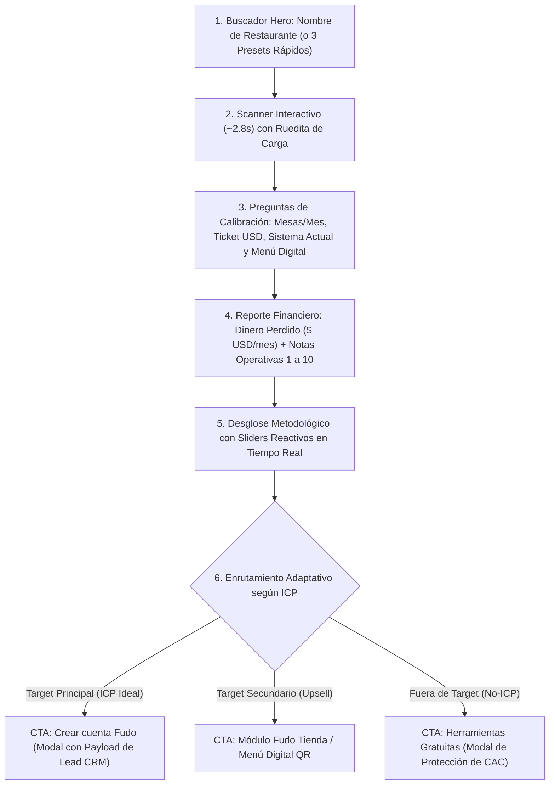

# Fudo Growth Challenge — Diagnóstico de Fuga Operativa y Captación Calificada

Herramienta interactiva de adquisición de clientes basada en **Engineering as Marketing (Product-Led Growth)** diseñada para **Fudo** (SaaS de gestión operativa y POS para restaurantes en Argentina, México, Colombia, Chile y Brasil).

---

## 🎯 1. ¿Qué es este proyecto y qué problema resuelve?

### El Contexto de Negocio
Fudo cuenta con un volumen orgánico significativo (**~80.000 visitas mensuales** a su sitio web), con una tasa de conversión a cuenta creada de ~1,2%, un CAC promedio por pauta paga de $200 USD y un ticket mensual de $50 USD/mes.

Históricamente, Fudo ofreció herramientas gratuitas (creador de sitios web, plantillas de Excel, calculadoras de comisiones, análisis de Google Maps). Aunque tenían tráfico y uso, **no generaban clientes pagos** debido a dos problemas estructurales:
1. **Desalineación de intención:** Atraían dueños buscando soluciones de marketing/redes sociales en lugar de software de gestión operativa y punto de venta.
2. **Selección adversa:** Captaban negocios diminutos sin volumen transaccional ni presupuesto, que buscan alternativas gratuitas y evitan pagar software.

### La Solución
Esta herramienta reemplaza el diagnóstico superficial de redes sociales por una **auditoría financiera y operativa de fuga silenciosa de dinero**:
* Atrae con un gancho de baja fricción (nombre del restaurante y escaneo de presencia pública).
* Detecta fricciones operativas reales en reseñas (*demoras en cocina*, *errores de facturación/comandas*, *menú estático en PDF*).
* Calibra la escala del negocio en vivo (pedidos mensuales, ticket promedio, sistema actual).
* **Calcula con total transparencia matemática cuánto dinero pierde el local al mes ($\text{USD/mes}$)**.
* **Filtra y enruta de forma inteligente al usuario según su calificación ICP**, protegiendo el CAC del equipo comercial.

---

## 🚀 2. ¿Cómo funciona el flujo?



1. **Ingreso / Búsqueda:** El usuario escribe el nombre de cualquier restaurante o hace clic en uno de los 3 casos representativos.
2. **Inspección Simulada (~2.8s):** Animación progresiva con rueditas de carga que conecta con Google Maps, realiza NLP sobre quejas operativas y revisa su canal digital.
3. **Calibración Activa:** Mientras se genera la expectativa, el usuario ajusta su volumen de pedidos, ticket promedio, si usa papel/Excel/POS, y si cuenta con carta digital interactiva o PDF.
4. **Reporte de Dinero Perdido & Evaluación (1 a 10):** Muestra el dinero que se fuga mensualmente y asigna una nota objetiva (1.0 a 10.0) a demoras, comandas y menú digital, con banner adaptativo (verde para operaciones optimizadas, rojo para críticas).
5. **Transparencia en la Fórmula:** Expone la fórmula matemática con deslizadores (*sliders*) reactivos: mover cualquier parámetro actualiza todo el reporte en vivo sin recargar la página.
6. **Enrutamiento Inteligente:**
   * **ICP Ideal:** Botón directo a prueba de 14 días con modal que expone el JSON del lead calificado que viajaría a la base de datos de Fudo.
   * **Software Satisfecho:** Botón para activar el módulo de canal online sin cambiar su POS.
   * **No-ICP:** Botones a las herramientas gratuitas reales de Fudo disparando una ventana modal que explica cómo se protegió el CAC filtrando prospectos no viables.

---

## 📊 3. Datos Ficticios y Escenarios de Demostración

La aplicación incluye **3 escenarios preconfigurados** que representan a los perfiles clave de la estrategia de growth, además de permitir ingresar **cualquier restaurante personalizado**:

| Escenario | Perfil de Negocio | Sistema Actual | Fuga Mensual Estimada | Nota Operativa | Acción / Enrutamiento de Growth |
| :--- | :--- | :--- | :--- | :--- | :--- |
| **Target Principal**<br>*(ICP Ideal)* | **Parrilla El Asador Criollo**<br>Alto volumen (~2.600 pedidos/mes, ticket $18 USD). Salón colapsado en horas pico. | Comanda manual en papel y notas manuscritas. | **~$1.100 USD/mes**<br>*(Demoras de 50 min y errores de facturación).* | **2.8 / 10**<br>*(Crítico)* | **CTA Directo a Fudo POS & Comanderas**.<br>Abre modal con el payload JSON del lead simulado para el CRM. |
| **Target Secundario**<br>*(Oportunidad Upsell)* | **Sushi Fusion & Rolls**<br>Volumen medio-alto (~1.800 pedidos/mes, ticket $24 USD). Salón prolijo. | Software POS actual (conforme con el sistema de salón). | **~$380 USD/mes**<br>*(Fuga acotada exclusivamente a delivery por carta PDF pesada).* | **9.2 / 10 Salón**<br>**4.5 / 10 Digital** | **CTA a Fudo Tienda & Menú Digital**.<br>Upsell complementario para venta directa sin comisiones sin reemplazar su POS actual. |
| **Fuera de Target**<br>*(No-ICP Filtrado)* | **Cafecito de Paso**<br>Micro-local al paso (14 cafés/día, ticket $3.5 USD). Sin salón ni delivery. | Cuaderno / Cobro manual en caja. | **~$32 USD/mes**<br>*(Insignificante: no amortiza un SaaS de $50 USD/mes).* | **6.8 / 10**<br>*(Micro-escala)* | **Filtrado Automático a Recursos Gratuitos**.<br>Deriva a *Calculadora de Rentabilidad de Platos* y *Plantilla Excel de Inventario*, activando el modal de CAC protegido. |
| **Caso Personalizado** | **Cualquier nombre ingresado**<br>*(Ej: Don Julio, Tacos DF, Pizzería Bella)* | Calibrable por el usuario en vivo. | Dinámica según sliders. | Calculada en tiempo real. | Se clasifica automáticamente en ICP, Upsell o No-ICP según sus respuestas. |

---

## 📐 4. Fórmula Matemática de Fuga Operativa

El reporte desglosa de manera transparente el cálculo de pérdida económica:

$$\text{Fuga Total (USD/mes)} = \text{Fuga Demoras} + \text{Fuga Comandas} + \text{Fuga Menú Digital}$$

1. **Fuga por Demoras de Cocina y Rotación Lenta (Salón):**
   $$\text{Pedidos Salón} \times \left(\frac{\% \text{Demora}}{100}\right) \times \left(\frac{\% \text{Abandono}}{100}\right) \times \text{Ticket Promedio}$$
2. **Fuga por Errores de Comanda y Facturación:**
   $$\text{Pedidos Totales} \times \left(\frac{\% \text{Error Comanda}}{100}\right) \times (\text{Ticket Promedio} \times \text{Factor Reposición } [0.5])$$
3. **Fuga por Menú Estático / Canal Digital (Delivery):**
   $$\text{Pedidos Delivery} \times \left(\frac{\% \text{Caída PDF}}{100}\right) \times \text{Ticket Promedio}$$
   *(Si el restaurante indica que ya cuenta con menú digital interactivo, este término se vuelve $0$ y el slider se desactiva automáticamente).*

---

## 🛠️ 5. Stack Tecnológico

* **Core:** React 19 + TypeScript + Vite.
* **Estilos:** Tailwind CSS v4 (`@tailwindcss/vite`).
* **Iconografía:** `lucide-react`.
* **Hosting / Despliegue:** **Cloudflare Pages**.
  * Build command: `npm run build`
  * Output directory: `dist`
  * Fallback SPA: `public/_redirects` (`/* /index.html 200`).

---

## 💻 6. Comandos para Ejecución y Verificación

### Instalar Dependencias:
```bash
npm install
# En Windows PowerShell usar: npm.cmd install
```

### Modo de Desarrollo Local:
```bash
npm run dev
# En Windows PowerShell usar: npm.cmd run dev
```

### Compilar para Producción:
```bash
npm run build
# En Windows PowerShell usar: npm.cmd run build
```

### Previsualizar Build Localmente:
```bash
npm run preview
# En Windows PowerShell usar: npm.cmd run preview
```

---

## 📖 7. Documentación Adicional

* [agents.md](agents.md): Guía de arquitectura, lineamientos de mantenimiento para futuros agentes y especificaciones de diseño.
* [CONVERSACION.md](CONVERSACION.md): Transcripción completa de la sesión de ideación estratégica, debate de growth, diseño de producto y todas las iteraciones de código.
